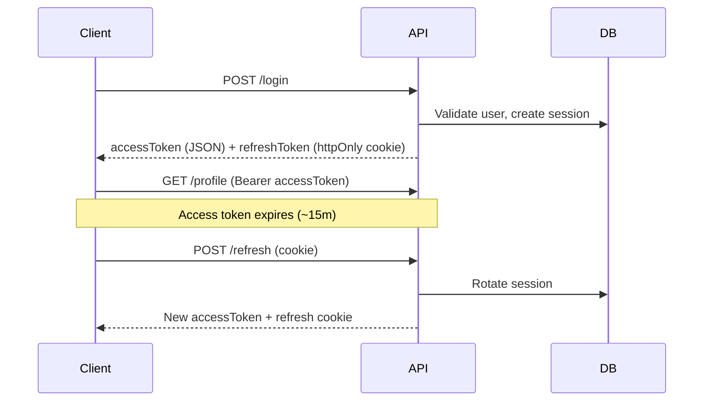

# Event Management System

A full-stack event management platform where organizers create and manage events, and attendees discover, register for, and track their events. Built with React, Node.js, Express, MongoDB, and a production-grade authentication layer.

## Features

### Authentication & security
- JWT **access tokens** (short-lived) + **refresh tokens** (HTTP-only cookies)
- bcrypt password hashing with configurable cost factor
- Email verification before login (configurable)
- Forgot password and secure token-based password reset
- Account lockout after repeated failed login attempts
- Logout (current session) and logout from all devices
- Role-based access control: `attendee`, `organizer`, `admin`

### Events
- Event posters uploaded to **Cloudinary** (JPEG, PNG, WebP) with auto-optimization
- Responsive poster delivery via stored variant URLs (`thumbnail`, `medium`, `large`)
- Old posters removed from Cloudinary on update/delete
- Event CRUD with QR codes
- Event registration with optional capacity limits
- Organizer and attendee dashboards
- Rate limiting, NoSQL injection sanitization, XSS protection, and Helmet security headers

## Tech Stack

| Layer    | Technologies |
|----------|--------------|
| Frontend | React 19, Vite, Tailwind CSS, Axios, React Router |
| Backend  | Node.js, Express 5, MongoDB, Mongoose |
| Auth     | JWT, bcryptjs, HTTP-only cookies, cookie-parser, Nodemailer |
| Media    | Cloudinary, Multer |
| Testing  | Jest, Supertest (server) · Vitest, Testing Library (client) |

## Project Structure

```
Events/
├── client/
│   └── src/
│       ├── components/       # UI components (Navbar, dashboards, etc.)
│       ├── pages/            # Landing, Login, Register, Events, Dashboard, …
│       └── utils/
│           ├── auth.js       # Token & user helpers (localStorage)
│           └── api.js        # Logout, refresh, authenticated fetch
├── server/
│   ├── config/               # Environment, DB, Cloudinary, security
│   ├── controllers/          # HTTP handlers (auth, events, registration)
│   ├── middleware/           # protect, authorize, logging, errors
│   ├── models/               # User, Session, Events
│   ├── routes/               # auth.routes, event.routes, registration.routes
│   ├── services/             # auth, session, email, event, registration
│   ├── validators/           # express-validator rules
│   ├── utils/                # tokens, cookies, crypto, ApiError, responses
│   ├── tests/
│   ├── app.js
│   └── server.js
├── Dockerfile
└── README.md
```

## Prerequisites

- Node.js 18+
- MongoDB (local or Atlas)
- Cloudinary account (event images)
- SMTP provider (e.g. Gmail, SendGrid, Mailgun) for email verification and password reset

## Getting Started

### 1. Install dependencies

```bash
git clone <repository-url>
cd Events

cd server && npm install
cd ../client && npm install
```

### 2. Environment variables

**`server/.env`**

```env
# Server
PORT=5000
NODE_ENV=development
MONGO_URI=mongodb://localhost:27017/events
CLIENT_URL=http://localhost:5173
ALLOWED_ORIGINS=http://localhost:5173

# JWT
JWT_SECRET=change_me_legacy_fallback
JWT_ACCESS_SECRET=change_me_access_secret
JWT_REFRESH_SECRET=change_me_refresh_secret
JWT_ACCESS_EXPIRES_IN=15m
JWT_REFRESH_MAX_AGE_MS=604800000

# Auth security
BCRYPT_ROUNDS=12
MAX_FAILED_LOGIN_ATTEMPTS=5
ACCOUNT_LOCK_DURATION_MS=900000
REQUIRE_EMAIL_VERIFICATION=true

# Email (SMTP)
EMAIL_FROM=noreply@yourdomain.com
EMAIL_HOST=smtp.yourprovider.com
EMAIL_PORT=587
EMAIL_SECURE=false
EMAIL_USER=your_smtp_user
EMAIL_PASS=your_smtp_password

# Cloudinary
CLOUDINARY_CLOUD_NAME=your_cloud_name
CLOUDINARY_API_KEY=your_api_key
CLOUDINARY_API_SECRET=your_api_secret
CLOUDINARY_FOLDER=event-management-app/posters
```

**`client/.env`**

```env
VITE_API_URL=http://localhost:5000
VITE_API_AUTH_URL=http://localhost:5000/api/auth
VITE_API_EVENTS_URL=http://localhost:5000/api/events
VITE_API_REGISTRATION_URL=http://localhost:5000/api/eventRegistration
```

**Local development tip:** Set `REQUIRE_EMAIL_VERIFICATION=false` in `server/.env` to skip email verification during development when SMTP is not configured. Verification and reset emails are logged to the console when `EMAIL_HOST` is unset.

### 3. Run the app

```bash
# Terminal 1 — API (from server/)
npm run dev

# Terminal 2 — client (from client/)
npm run dev
```

| Service  | URL |
|----------|-----|
| API      | http://localhost:5000 |
| Frontend | http://localhost:5173 |

## Authentication

### How it works



| Token | Default lifetime | Client storage | Purpose |
|-------|------------------|----------------|---------|
| Access | 15 minutes | `localStorage` + `Authorization` header | Authorize API requests |
| Refresh | 7 days | HTTP-only cookie (`refreshToken`) | Renew access token silently |

### Security controls

| Control | Description |
|---------|-------------|
| Password hashing | bcrypt with 12 rounds (configurable via `BCRYPT_ROUNDS`) |
| Failed login lockout | Account locked after `MAX_FAILED_LOGIN_ATTEMPTS` (default 5) |
| Email verification | Required when `REQUIRE_EMAIL_VERIFICATION=true` |
| Opaque tokens | Verification and reset tokens stored as SHA-256 hashes |
| Session revocation | Logout, password reset, and logout-all invalidate sessions |
| Token versioning | `logout-all` bumps `tokenVersion` and invalidates all access tokens |

### Role-based access

Restrict routes by role with the `authorize` middleware:

```javascript
const protect = require('../middleware/auth.middleware');
const authorize = require('../middleware/authorize.middleware');

router.delete('/users/:id', protect, authorize('admin'), deleteUser);
router.post('/events', protect, authorize('organizer', 'admin'), createEvent);
```

Public registration only allows `attendee` or `organizer`. The `admin` role must be assigned directly in the database.

### Client session handling

- **Login / register:** stores `accessToken` (and `token` alias) in `localStorage`; refresh token is set automatically via cookie.
- **API calls:** send `Authorization: Bearer <accessToken>` and `credentials: 'include'` for cookie-backed refresh.
- **Logout:** call `POST /api/auth/logout` to revoke the server session and clear the refresh cookie.
- **Pages:** `/forgot-password`, `/reset-password?token=…`, `/verify-email?token=…`

## API Reference

### Auth

| Method | Endpoint | Auth | Description |
|--------|----------|------|-------------|
| `POST` | `/api/auth/register` | — | Register (`attendee` or `organizer`) |
| `POST` | `/api/auth/login` | — | Login; returns access token + refresh cookie |
| `POST` | `/api/auth/refresh` | Cookie | Issue new access token |
| `POST` | `/api/auth/logout` | Cookie | End current session |
| `POST` | `/api/auth/logout-all` | Bearer | End all sessions for user |
| `GET` | `/api/auth/profile` | Bearer | Current user profile |
| `POST` | `/api/auth/verify-email` | — | Verify email (`{ "token": "…" }`) |
| `GET` | `/api/auth/verify-email?token=` | — | Verify email via link |
| `POST` | `/api/auth/resend-verification` | — | Resend verification email |
| `POST` | `/api/auth/forgot-password` | — | Send password reset email |
| `POST` | `/api/auth/reset-password` | — | Reset password (`token`, `password`) |

### Events

| Method | Endpoint | Auth | Description |
|--------|----------|------|-------------|
| `GET` | `/api/events` | — | List events |
| `GET` | `/api/events/:id` | — | Event details |
| `GET` | `/api/events/mine/me` | Bearer | Organizer's events |
| `GET` | `/api/events/registered/me` | Bearer | Attendee's registrations |
| `GET` | `/api/events/:eventId/attendees` | Bearer | Attendees (organizer only) |
| `POST` | `/api/events` | Bearer | Create event |
| `PUT` | `/api/events/:id` | Bearer | Update event |
| `DELETE` | `/api/events/:id` | Bearer | Delete event |

### Registration

| Method | Endpoint | Auth | Description |
|--------|----------|------|-------------|
| `POST` | `/api/eventRegistration/:eventId/register` | Bearer | Register for event |
| `DELETE` | `/api/eventRegistration/:eventId/cancel` | Bearer | Cancel registration |
| `GET` | `/api/eventRegistration/:eventId/attendees` | Bearer | List attendees (organizer) |

### Health

| Method | Endpoint | Description |
|--------|----------|-------------|
| `GET` | `/` | API health check |

Protected routes require `Authorization: Bearer <accessToken>`.

## Backend Architecture

| Layer | Responsibility |
|-------|----------------|
| **Routes** | HTTP paths, middleware chain, validation |
| **Controllers** | Parse requests, set cookies, format responses |
| **Services** | Business logic (`auth`, `session`, `email`, `event`, `registration`) |
| **Models** | `User`, `Session`, `Events` Mongoose schemas |
| **Middleware** | `protect`, `authorize`, `asyncHandler`, logging, global errors |
| **Validators** | `express-validator` input rules |
| **Utils** | JWT access tokens, cookie helpers, `ApiError`, crypto hashing |

## Testing

```bash
# Server — 27 tests, in-memory MongoDB (from server/)
npm test

# Client (from client/)
npm test
```

Test environment (`server/tests/env.js`) disables email verification and uses fast bcrypt rounds. Auth security tests cover refresh cookies, account lockout, and logout-all.

## Docker

```bash
docker build -t events-app .
docker run -p 5000:5000 --env-file server/.env events-app
```

The image builds the Vite client and serves it from the Express `public` folder.

## Scripts

| Location | Command | Description |
|----------|---------|-------------|
| `server/` | `npm run dev` | API with nodemon |
| `server/` | `npm start` | Production API |
| `server/` | `npm test` | Jest test suite |
| `client/` | `npm run dev` | Vite dev server |
| `client/` | `npm run build` | Production build |
| `client/` | `npm test` | Vitest tests |

## License

ISC
